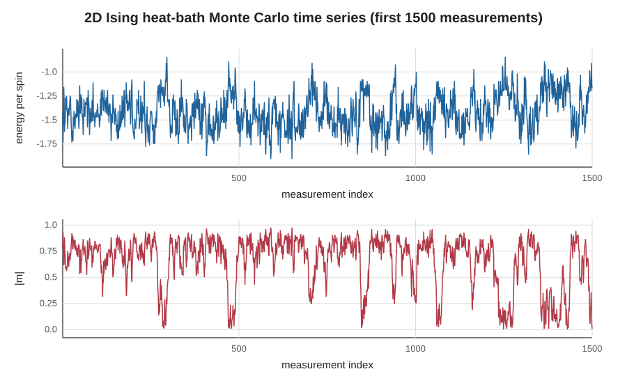
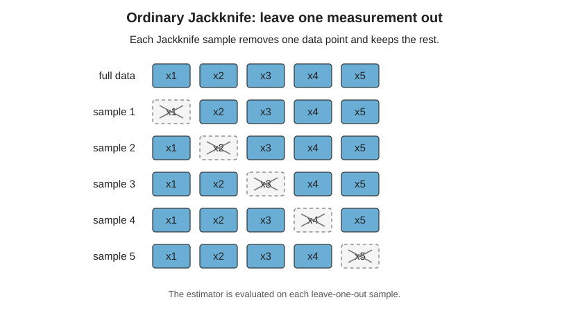
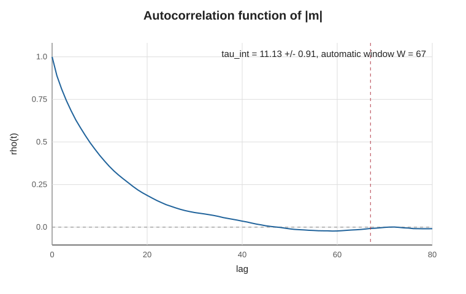
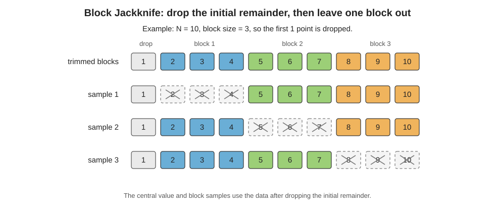
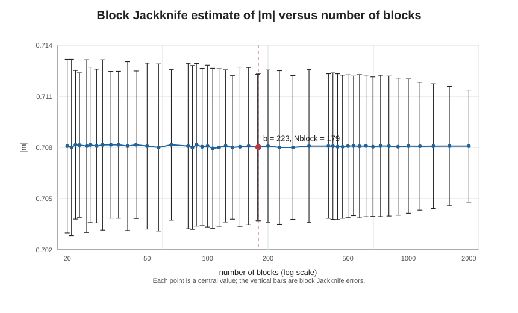
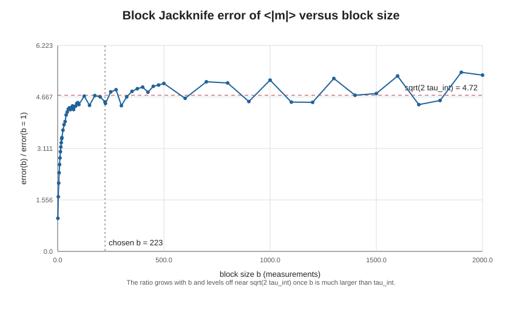
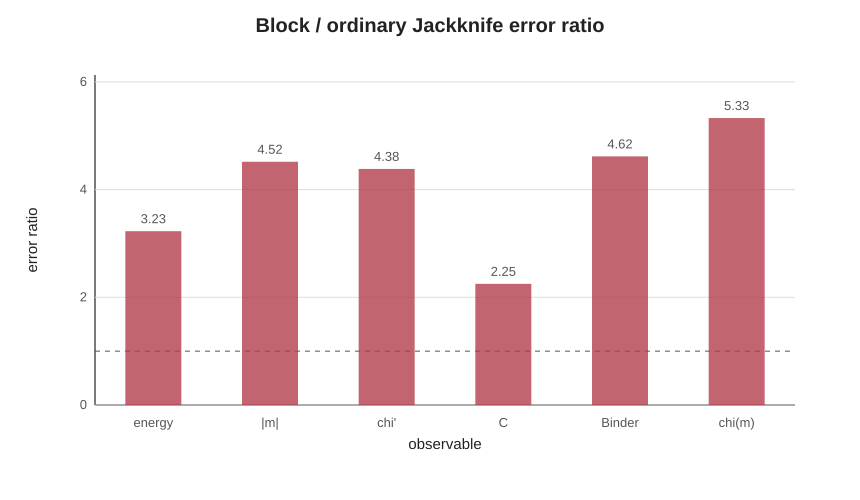
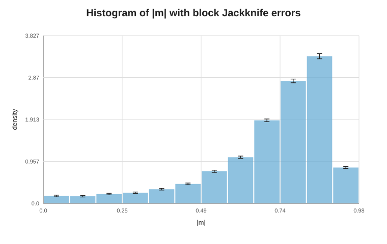

# 2D Ising Model and Jackknife Analysis

このノートでは、2 次元 Ising 模型を題材に、Monte Carlo 測定値の統計誤差、
自己相関、誤差の伝播、Jackknife 法、Block Jackknife 法、相関のある複数の
測定列から作る量、histogram の誤差棒を順に扱う。解析には JackknifeTools を使う。

実行例は次の script に入っている。

```bash
julia --project=. tutorials/ising2d_jackknife.jl
```

## 1. イジング模型

2 次元正方格子上の各 site $i$ に spin

$$
s_i = \pm 1
$$

を置く。最近接相互作用のみを考え、周期境界条件を課す。結合定数を
$J=1$、Boltzmann constant を $k_B=1$ とする。Hamiltonian は以下で与えられる。

$$
E[s] = - \sum_{\langle i,j\rangle} s_i s_j
$$

ここで $\langle i,j\rangle$ は最近接 pair を表し、各 bond は一度だけ数える。

$L \times L$ 格子では spin 数は

$$
N_\mathrm{spin} = L^2
$$

である。energy density と magnetization density を以下で定義する。

$$
e = \frac{E}{N_\mathrm{spin}},
\qquad
m = \frac{1}{N_\mathrm{spin}}\sum_i s_i
$$

### 厳密解と相転移点

2 次元正方格子 Ising 模型は、外場 $h=0$ の場合に熱力学極限で厳密に解ける。
Onsager の厳密解により free energy は解析的に求まり、2 次相転移が存在する
ことが分かる。ここで

$$
K = \beta J
$$

と書くと、等方的な正方格子 Ising 模型の臨界点は以下で与えられる。

$$
\sinh(2K_c)=1
$$

この tutorial では $J=1$ なので

$$
\beta_c
= \frac{1}{2}\log(1+\sqrt{2})
\simeq 0.4406867935,
$$

$$
T_c
= \frac{2}{\log(1+\sqrt{2})}
\simeq 2.269185314
$$

である。

$\beta < \beta_c$ は高温相で、熱力学極限では自発磁化は 0 である。
$\beta > \beta_c$ は低温相で、$\mathbb{Z}_2$ 対称性が自発的に破れ、自発磁化が
現れる。Yang の結果による自発磁化は以下である。

$$
m_0(\beta)
=
\left[
1 - \sinh^{-4}(2\beta)
\right]^{1/8}
\qquad (\beta > \beta_c)
$$

一方、有限体積で外場がない場合は、spin flip 対称性のため
$\langle m\rangle=0$ になる。数値計算で秩序変数の大きさを見るときに
$\langle |m| \rangle$ や $\langle m^2\rangle$ を使うのは、この対称性のためである。
有限体積では $m$ の符号が時々反転し、その反転がどのくらいの頻度で起こるかが
6 節と 10 節で問題になる。

この tutorial の default 値 $\beta=0.44$ は $\beta_c$ に近い。揺らぎが大きく
自己相関も長くなるので、block Jackknife の効果を見る例に向いている。

この tutorial の code では、energy per spin を次のように測る。

```julia
function energy_per_spin(spins)
    L = size(spins, 1)
    energy = 0
    for i in 1:L
        ip = i == L ? 1 : i + 1
        for j in 1:L
            jp = j == L ? 1 : j + 1
            energy -= spins[i, j] * (spins[ip, j] + spins[i, jp])
        end
    end
    return energy / length(spins)
end
```

右方向と上方向の bond だけを足すので、各最近接 bond を一度だけ数える。

magnetization per spin は以下である。

```julia
function magnetization_per_spin(spins)
    return sum(spins) / length(spins)
end
```

## 2. 熱浴法

Monte Carlo では、Boltzmann 分布

$$
P[s] = \frac{1}{Z} e^{-\beta E[s]}
$$

に従う configuration を生成したい。ただし

$$
\beta = \frac{1}{T},
\qquad
Z = \sum_s e^{-\beta E[s]}
$$

である。

熱浴法では、周囲の spin を固定したまま、site $i$ の spin $s_i$ を
条件付き確率から直接引き直す。近傍 spin の和を

$$
h_i = \sum_{j\in\mathrm{nn}(i)} s_j
$$

とすると、site $i$ に関係する energy は $E_i = -s_i h_i$ である。よって
条件付き確率は以下のようになる。

$$
P(s_i=+1 \mid \{s_j\}_{j\ne i})
=
\frac{e^{\beta h_i}}{e^{\beta h_i}+e^{-\beta h_i}}
=
\frac{1}{1+e^{-2\beta h_i}},
$$

$$
P(s_i=-1 \mid \{s_j\}_{j\ne i})
=
\frac{e^{-\beta h_i}}{e^{\beta h_i}+e^{-\beta h_i}}
=
\frac{1}{1+e^{2\beta h_i}}.
$$

code では次のように書いている。

```julia
neighbor_sum = spins[ip, j] + spins[im, j] + spins[i, jp] + spins[i, jm]
probability_plus = 1 / (1 + exp(-2 * beta * neighbor_sum))
spins[i, j] = rand_float!(rng) < probability_plus ? Int8(1) : Int8(-1)
```

Metropolis 法のような「提案して受理・棄却する」手順ではなく、局所的な
条件付き分布から新しい spin を直接選ぶ。

1 sweep は $N_\mathrm{spin}$ 回の single-site update で定義する。site は
毎回ランダムに選ぶので、1 sweep で平均して全 site を 1 回ずつ更新する。

## 3. 熱化と測定

初期 configuration は平衡分布から出ていないので、最初の数 sweep は熱化のために
捨てる。

```julia
measurements = run_ising2d(;
    L=16,
    beta=0.44,
    therm_sweeps=500,
    sweeps=200000,
    measure_every=5,
    seed=20260515,
)
```

この設定では、まず 500 sweep を捨てる。その後 200000 sweep を進め、
5 sweep ごとに測定するので、測定数は以下である。

$$
N_\mathrm{meas} = \frac{200000}{5} = 40000
$$

測定数を多めにしているのは、11 節で block size を変えたときに誤差が
平坦になるところまで見るためである。測定数が少ないと、平坦になる前に
block 数が尽きる。

戻り値には、測定列が入っている。

```julia
measurements.energies
measurements.magnetizations
measurements.abs_magnetizations
```

ここで `energies` は $e_k$、`magnetizations` は $m_k$、
`abs_magnetizations` は $|m_k|$ の列である。

実行結果と図は次で再生成できる。

```bash
julia --project=. tutorials/make_tutorial_artifacts.jl
```

出力の全文は [results/ising2d_output.txt](results/ising2d_output.txt) に
保存している。最初の部分には、simulation parameter と測定数が出る。

```text
2D Ising Jackknife tutorial
L = 16, beta = 0.44
update = heat bath
measurements = 40000, measure_every = 5
```

この段階で見るべきものは、測定列そのものである。

**図 1. Energy density と absolute magnetization density の時系列**



図 1 は、熱化後に測定した energy density $e$ と absolute magnetization
density $|m|$ の最初の 1500 測定である。$|m|$ は 0.7 から 0.9 のあたりに
長くとどまり、時々 0 付近まで落ちる。0 付近を通るとき、$m$ の符号が
反転することがある。

## 4. 統計誤差

独立な測定値

$$
x_1,x_2,\dots,x_N
$$

から平均

$$
\bar{x} = \frac{1}{N}\sum_{i=1}^N x_i
$$

を推定する。母分散を標本分散

$$
s^2 =
\frac{1}{N-1}
\sum_{i=1}^N (x_i-\bar{x})^2
$$

で推定すると、平均値の標準誤差は以下になる。

$$
\mathrm{SE}(\bar{x}) = \sqrt{\frac{s^2}{N}}
$$

Monte Carlo 測定では、測定値が Markov chain に沿って生成されるため、一般には
独立ではない。自己相関がある場合、有効な独立 sample 数は $N$ より小さくなる。
このとき平均値の分散は、おおまかに以下で書ける。

$$
\mathrm{Var}(\bar{x})
\simeq
\frac{2\tau_\mathrm{int}}{N} C(0)
$$

ここで $C(0)$ は分散、$\tau_\mathrm{int}$ は integrated autocorrelation time
である (10 節)。

## 5. Primary observable

各 configuration で直接測る量を primary observable と呼ぶ。この tutorial では

$$
e_k = \frac{E_k}{N_\mathrm{spin}},
\qquad
|m_k|
$$

を primary observable とする。

JackknifeTools では、平均値と Jackknife error を

```julia
energy = jk_meanerror(energies)
abs_magnetization = jk_meanerror(abs_magnetizations)
```

で計算できる。戻り値は `(central_value, error)` である。平均には $O(N)$ の
公式を使うので、測定数が 10 万を超えてもすぐに終わる。

この code に対する実行結果は次である。

```text
Ordinary Jackknife: primary observables
energy per spin                  -1.44741016 +/- 0.00087153
abs magnetization per spin       0.70797871 +/- 0.00096739
```

energy per spin は負で、近接 spin がそろう configuration が多いことを表す。
$|m|$ は有限体積で見た秩序変数の大きさである。ここでの error は
ordinary Jackknife によるもので、自己相関を考えていない。11 節で見るように、
実際の誤差はこの 3 倍から 5 倍ある。

## 6. Secondary observable

測定列全体から作る非線形な量を secondary observable と呼ぶ。
典型例は susceptibility、specific heat、Binder ratio である。

### Susceptibility

susceptibility は magnetization の揺らぎで、教科書的には以下で定義する。

$$
\chi =
N_\mathrm{spin}\beta
\left(
\langle m^2\rangle - \langle m\rangle^2
\right)
$$

有限体積では、この定義をそのまま使うと困る。$\langle m\rangle$ は
$m$ の符号の反転を十分な回数だけ見て初めて 0 に近づくので、$\chi$ の
推定値と誤差は、符号の反転の頻度で決まってしまう。この tutorial の実行では、
40000 測定の間に $m$ の符号は 340 回ほどしか反転しない (10 節で
$\tau_\mathrm{int}\simeq 343$ を見る)。測定が短く、符号がほとんど
反転しないうちに止めると、$\langle m\rangle^2 \simeq \langle m^2\rangle$ と
なって $\chi$ は小さく出る。

そこで有限体積の Monte Carlo では、$m$ の代わりに $|m|$ を使った

$$
\chi' =
N_\mathrm{spin}\beta
\left(
\langle m^2\rangle - \langle |m|\rangle^2
\right)
$$

をよく使う。$m^2 = |m|^2$ なので、$\chi'$ は $|m|$ の列の分散から作れる。

```julia
susceptibility = x -> Nspin * beta * var(x, corrected=false)
chi_val, chi_err = jk_meanerror(abs_magnetizations, susceptibility)   # chi'
chi_m_val, chi_m_err = jk_meanerror(magnetizations, susceptibility)    # chi (signed m)
```

$\chi'$ と $\chi$ は異なる量である。臨界点付近の有限サイズスケーリングでは、
どちらも $L^{\gamma/\nu}$ で増えるが、係数が異なる。

### Specific heat

energy density $e$ を使い、以下で定義する。

$$
C =
N_\mathrm{spin}\beta^2
\left(
\langle e^2\rangle - \langle e\rangle^2
\right)
$$

```julia
specific_heat = x -> Nspin * beta^2 * var(x, corrected=false)
cv_val, cv_err = jk_meanerror(energies, specific_heat)
```

### Binder ratio

JackknifeTools の `"binder"` と `"bin"` は以下を返す。

$$
B =
\frac{\langle m^4\rangle}{\langle m^2\rangle^2}
$$

```julia
binder_val, binder_err = jk_meanerror(magnetizations, "binder")
```

$B$ は $m$ の偶数次だけで書けるので、符号の反転の影響を受けない。
別の convention として Binder cumulant

$$
U =
1 -
\frac{\langle m^4\rangle}{3\langle m^2\rangle^2}
= 1 - \frac{B}{3}
$$

を使うことも多い。その場合は関数として渡す。

```julia
binder_cumulant = x -> 1 - mean(x .^ 4) / (3 * mean(x .^ 2)^2)
u_val, u_err = jk_meanerror(magnetizations, binder_cumulant)
```

この tutorial の実行結果では、secondary observable は次のようになる。

```text
Ordinary Jackknife: secondary observables
susceptibility chi'              4.2164426 +/- 0.04220284
chi from signed m                60.5223882 +/- 0.12940028
specific heat                    1.50575821 +/- 0.00986434
Binder ratio                     1.17235903 +/- 0.00162543
```

susceptibility と specific heat は分散から作る量なので、平均だけでなく
揺らぎの大きさを測っている。$\chi$ と $\chi'$ の値が 1 桁以上異なるのは、
$\chi$ の $\langle m\rangle^2$ がほぼ 0 なのに対し、$\chi'$ の
$\langle|m|\rangle^2 \simeq 0.50$ が $\langle m^2\rangle$ の大部分を
打ち消すためである。Binder ratio は分布の形、特に $m^2$ と $m^4$ の関係を
見る量であり、有限サイズスケーリングでもよく使う。

## 7. 誤差の伝播

複数の推定量

$$
a_1,a_2,\dots,a_p
$$

から

$$
y = f(a_1,\dots,a_p)
$$

を作るとする。共分散行列を

$$
\Sigma_{ij}
=
\mathrm{Cov}(a_i,a_j)
$$

とすると、線形近似による誤差伝播は以下である。

$$
\sigma_y^2
\simeq
\sum_{i,j}
\frac{\partial f}{\partial a_i}
\Sigma_{ij}
\frac{\partial f}{\partial a_j}
$$

独立な 2 変数 $a,b$ の関数 $y=f(a,b)$ なら

$$
\sigma_y^2
\simeq
\left(\frac{\partial f}{\partial a}\right)^2\sigma_a^2
+
\left(\frac{\partial f}{\partial b}\right)^2\sigma_b^2
$$

となる。相関がある場合は交差項

$$
2
\frac{\partial f}{\partial a}
\frac{\partial f}{\partial b}
\mathrm{Cov}(a,b)
$$

も必要である。

secondary observable では、この共分散を手で扱うのが面倒になる。例えば
$\chi'$ では、$\langle m^2\rangle$ と $\langle |m|\rangle$ の相関を含めて
誤差を伝播させる必要がある。Jackknife 法は、この誤差伝播を resampling に
よってまとめて扱う方法である。12 節では、相関を無視するとどのくらい
誤差を間違えるかを実際に見る。

## 8. Jackknife 法

測定列

$$
x = (x_1,\dots,x_N)
$$

から estimator

$$
\theta = f(x)
$$

を作る。leave-one-out Jackknife では、1 点ずつ抜いた sample

$$
x^{(i)}
=
(x_1,\dots,x_{i-1},x_{i+1},\dots,x_N)
$$

を作り、$\theta_i = f(x^{(i)})$ を計算する。この $\theta_i$ を Jackknife
replica と呼ぶことにする。replica の平均を

$$
\bar{\theta}_\mathrm{JK}
=
\frac{1}{N}\sum_{i=1}^N \theta_i
$$

とすると、Jackknife error は以下で与えられる。

$$
\sigma_\theta
=
\sqrt{
\frac{N-1}{N}
\sum_{i=1}^N
\left(
\theta_i-\bar{\theta}_\mathrm{JK}
\right)^2
}
$$

JackknifeTools では central value は full sample から計算する。

$$
\theta_\mathrm{central}
=
f(x_1,\dots,x_N)
$$

error は replica から計算する。非線形な secondary observable でも同じ書き方で
扱える。

```julia
chi_val, chi_err = jk_meanerror(abs_magnetizations, susceptibility)
binder_val, binder_err = jk_meanerror(magnetizations, "binder")
```

小さな例で見ると、ordinary Jackknife は次のように 1 点ずつ抜く。

```julia
x = [10.0, 12.0, 13.0, 15.0]

jk_index_set(1:4)
# [[2, 3, 4], [1, 3, 4], [1, 2, 4], [1, 2, 3]]

jk_meanerror(x)
# (12.5, 1.0408329997330668)
```

1 つ目の sample は $x_1$ を抜いた $(x_2,x_3,x_4)$、2 つ目は $x_2$ を抜いた
$(x_1,x_3,x_4)$ である。同じことを全ての点について行い、得られた estimator の
揺らぎから error を作る。平均の場合、Jackknife error は 4 節の
$\mathrm{SE}(\bar x)$ と厳密に一致する。

**図 2. Ordinary Jackknife の leave-one-out sample**



replica そのものが欲しいときは `jk_replicas` を使う。後段の fit に
replica ごとの値を渡すときに必要になる。

```julia
rep = jk_replicas(abs_magnetizations, susceptibility; block=block_size)
rep.central      # full sample (block を使うときは先頭の余りを除いたもの) での値
rep.replicas     # theta_i の列
jk_error(rep.replicas)
```

`jk_index_set` は全ての部分集合を配列として返すので、メモリが $N^2$ で増える。
`jk_meanerror` や `jk_replicas` はこの関数を使わず、1 本の作業用配列を
使い回すので、メモリは $O(N)$ で済む。

## 9. 自己相関関数

Markov chain に沿った測定列では、近い測定同士が相関する。平均を
$\bar{x} = \frac{1}{N}\sum_i x_i$ とし、lag $t$ の自己相関関数を以下で定義する。

$$
C(t)
=
\frac{1}{N-t}
\sum_{i=1}^{N-t}
(x_i-\bar{x})(x_{i+t}-\bar{x})
$$

規格化した自己相関関数は

$$
\rho(t) = \frac{C(t)}{C(0)}
$$

である。$t=0$ では $\rho(0)=1$ であり、相関がなくなると $\rho(t)\to 0$ へ
近づく。

JackknifeTools では `jk_autocorr(series, max_lag)` が
$\rho(0),\dots,\rho(t_\mathrm{max})$ を返す。

```julia
rho = jk_autocorr(abs_magnetizations, 100)
```

この code に対応する図は次である。

**図 3. Absolute magnetization density の自己相関関数**



$\rho(t)$ は $t=0$ で 1 から始まり、lag が大きくなると 0 に近づく。
$\beta=0.44$ は厳密な臨界点に近いため、$|m|$ の相関は数十測定にわたって残る。
赤い破線は、次節の自動 window の位置である。

## 10. 自己相関時間

integrated autocorrelation time は以下で定義される。

$$
\tau_\mathrm{int}(W)
=
\frac{1}{2}
+
\sum_{t=1}^{W} \rho(t)
$$

理想的には $W$ を十分大きく取るが、大きい $t$ の $\rho(t)$ は noisy で、
足すほど雑音が増える。`jk_tau_int` は Sokal の自動 window を使い、

$$
W \ge c\,\tau_\mathrm{int}(W)
$$

を満たす最小の $W$ で和を止める。default は $c=6$ である。
$\tau_\mathrm{int}$ の統計誤差は Madras と Sokal の近似式

$$
\delta\tau_\mathrm{int}
\simeq
\tau_\mathrm{int}\sqrt{\frac{2(2W+1)}{N}}
$$

で見積もる。

```julia
tau = jk_tau_int(abs_magnetizations)
tau.tau_int, tau.error, tau.window
```

`window=:first_nonpositive` を渡すと、$\rho(t)$ が初めて 0 以下になる手前で
止める。整数を渡すと、その $W$ をそのまま使う。

自己相関があると、平均値の誤差は独立 sample の場合より大きくなる。
よく使われる目安は以下である。

$$
N_\mathrm{eff}
\simeq
\frac{N}{2\tau_\mathrm{int}}
$$

$\tau_\mathrm{int}$ が大きいほど、有効統計数は小さくなる。

この tutorial の実行結果は次である。

```text
Integrated autocorrelation time (automatic window, c = 6)
tau_int of |m|                   11.132 +/- 0.915 measurement intervals (window = 67)
tau_int of energy                5.72 +/- 0.341 measurement intervals (window = 35)
tau_int of signed m              343.063 +/- 155.688 measurement intervals (window = 2059)
```

測定は 5 sweep ごとなので、この値は「測定 index 単位」の自己相関時間である。
sweep 単位に直すと、$|m|$ では $11\times 5 \simeq 56$ sweep 程度の相関が
残っていると読める。

符号つきの $m$ の $\tau_\mathrm{int}$ は $|m|$ の 30 倍ある。$m$ が長く
変化しないのは、符号が反転するまでの待ち時間が長いためである。6 節で
$\chi'$ を主に使ったのは、この遅い自由度を避けるためである。

## 11. Block Jackknife

自己相関がある場合、1 点ずつ抜く Jackknife では誤差を過小評価する。
Block Jackknife では、連続した測定値を block にまとめ、1 block ずつ抜く。

測定数を $N$、block size を $b$ とする。JackknifeTools では

$$
r = N \bmod b
$$

個の先頭データを捨て、残りを同じ大きさの block に分ける。先頭を捨てるのは、
熱化の影響が序盤に残りやすいためである。

block 数は以下である。

$$
N_\mathrm{block}
=
\frac{N-r}{b}
$$

block Jackknife の replica は、1 block を抜いた測定列から作る。
block Jackknife error は leave-one-out Jackknife と同じ形で、
$N$ の代わりに $N_\mathrm{block}$ を使う。

$$
\sigma_\theta^\mathrm{block}
=
\sqrt{
\frac{N_\mathrm{block}-1}{N_\mathrm{block}}
\sum_{a=1}^{N_\mathrm{block}}
\left(
\theta_a-\bar{\theta}_\mathrm{block}
\right)^2
}
$$

例えば $N=10$、$b=3$ なら $r=1$ なので、先頭の 1 点を捨てる。
残った $2,\dots,10$ を 3 つの block に分ける。

```julia
jk_block_index_set(1:10, 3)
# [[5, 6, 7, 8, 9, 10],
#  [2, 3, 4, 8, 9, 10],
#  [2, 3, 4, 5, 6, 7]]

jk_meanerror(collect(1.0:10.0); block=3)
# (6.0, 1.7320508075688772)
```

central value も replica も、先頭の余りを捨てた後のデータから作る。
この例の central value は $(2+3+\cdots+10)/9=6$ である。

**図 4. Block Jackknife の block 分割と leave-one-block-out sample**



実際の code は、普通の API に `block` keyword を渡すだけでよい。

```julia
block_size = 223

energy_block = jk_meanerror(energies; block=block_size)
chi_block = jk_meanerror(abs_magnetizations, susceptibility; block=block_size)
binder_block = jk_meanerror(magnetizations, "binder"; block=block_size)
```

### block size の選び方

平均の block Jackknife error は、$b$ が $\tau_\mathrm{int}$ の数倍程度だと小さく出る。
誤差の 2 乗で見て、ずれは相対的に $\tau_\mathrm{int}/b$ の程度である。$\rho(t)$ が指数関数で
減衰するなら、$b=10\,\tau_\mathrm{int}$ でも誤差は 5% ほど小さい。
この tutorial では

$$
b = 20\,\tau_\mathrm{int}
$$

を出発点にする。$\tau_\mathrm{int}$ は $|m|$ と $e$ の大きい方を使い、
block 数が 50 を下回らないように上限を付ける。

```julia
tau = max(jk_tau_int(abs_magnetizations).tau_int, jk_tau_int(energies).tau_int)
block_size = suggested_block_size(tau, length(abs_magnetizations))
```

この例では $\tau_\mathrm{int}\simeq 11.13$ なので、block size は 223、
block 数は 179 になる。実行結果は次である。

```text
Using block_size = 223 (20 tau_int of |m| and energy)

Block Jackknife
energy per spin                  -1.44744642 +/- 0.00281301
abs magnetization per spin       0.70791717 +/- 0.0043698
susceptibility chi'              4.22283832 +/- 0.18501302
chi from signed m                60.53082849 +/- 0.68955279
specific heat                    1.50707088 +/- 0.02219401
Binder ratio                     1.17259567 +/- 0.0075044
```

ordinary Jackknife と block Jackknife の central value はほぼ同じだが、
error は block Jackknife の方が 2 倍から 5 倍大きい。

$b=20\,\tau_\mathrm{int}$ は出発点に過ぎないので、`jk_block_scan` で
block size を変えながら確かめる。

```julia
scan = jk_block_scan(abs_magnetizations; blocks=[1:2:19; 20:5:95; 100:25:475])
scan.block_sizes, scan.nblocks, scan.values, scan.errors
```

**図 5. Block 数に対する $|m|$ の中心値と Block Jackknife error**



block size を大きくすると、1 block に含まれる測定点が増え、block 数は減る。
中心値は error bar の範囲で安定していて、block size の取り方が結果を
変えていないことが分かる。

**図 6. Block size に対する Block Jackknife error の増え方**



図 6 は、$|m|$ の平均の block Jackknife error を $b=1$ の error で割った比である。
比は $b$ とともに増え、$b$ が $\tau_\mathrm{int}$ より十分大きくなると
4 節の式から期待される

$$
\frac{\sigma^\mathrm{block}}{\sigma^\mathrm{ordinary}}
\to
\sqrt{2\tau_\mathrm{int}}
\simeq 4.72
$$

の近くで平坦になる。選んだ $b=223$ は平坦な領域に入っている。$b$ が大きい
ところで比がばらつくのは、block 数が減って error の推定自体の誤差が
大きくなるためである (block 数 $n$ に対して相対誤差はおよそ
$1/\sqrt{2n}$)。

**図 7. Block Jackknife error と ordinary Jackknife error の比**



図 7 は observable ごとの比である。secondary observable では、非線形変換と
相関の両方が効くため、誤差の増え方も observable ごとに異なる。

符号つきの $m$ から作る $\chi$ には、この $b$ は小さすぎる。
$\tau_\mathrm{int}\simeq 343$ に対して $20\,\tau_\mathrm{int}$ は 7000 近くあり、
40000 測定では block が 6 個ほどしか作れない。$\chi$ の誤差を正しく
見積もるには、測定をあと 1 桁以上増やす必要がある。

## 12. 複数の測定列から作る量

同じ configuration で測った複数の量から secondary observable を作ることがある。
例として $\langle |m|\rangle$ の $\beta$ 微分を考える。

$$
\langle O\rangle
=
\frac{1}{Z}\sum_s O[s]\,e^{-\beta E[s]}
$$

を $\beta$ で微分すると、$E = N_\mathrm{spin} e$ を使って以下が得られる。

$$
\frac{\partial\langle |m|\rangle}{\partial\beta}
=
-N_\mathrm{spin}
\left(
\langle |m|\,e\rangle - \langle |m|\rangle\langle e\rangle
\right)
$$

右辺は $|m|$ の列と $e$ の列の両方から作る。JackknifeTools では、関数を
先頭に置き、列を順に渡す。全ての列から同じ測定 (block を使うときは同じ
block) を抜くので、列どうしの相関が保たれる。

```julia
dabsm_dbeta = (m, e) -> -Nspin * (mean(m .* e) - mean(m) * mean(e))
value, error = jk_meanerror(dabsm_dbeta, abs_magnetizations, energies; block=block_size)

# do block でも書ける
value, error = jk_meanerror(abs_magnetizations, energies; block=block_size) do m, e
    -Nspin * (mean(m .* e) - mean(m) * mean(e))
end
```

比較のため、$\langle |m|e\rangle$、$\langle |m|\rangle$、$\langle e\rangle$ を
それぞれ block Jackknife で求め、互いに独立だとみなして 7 節の式で
誤差を伝播させてみる。

```text
Two correlated series: d<|m|>/d beta = -N_spin (<|m| e> - <|m|><e>)
block Jackknife                  7.07123106 +/- 0.20215812
error if treated as independent  2.57712617
correlation of <|m|> and <e>     -0.9618
```

独立とみなした誤差は 12 倍以上大きい。$\langle |m|e\rangle$ と
$\langle |m|\rangle\langle e\rangle$ は強く相関していて、差を取ると揺らぎの
大部分が打ち消し合う。独立とみなすと、この打ち消しが入らない。

最後の行は $\langle |m|\rangle$ と $\langle e\rangle$ の相関係数で、
`jk_meancov` で求めた共分散行列から計算している。

```julia
two_means = (m, e) -> [mean(m), mean(e)]
central, cov = jk_meancov(two_means, abs_magnetizations, energies; block=block_size)
cov[1, 2] / sqrt(cov[1, 1] * cov[2, 2])
```

ベクトルを返す関数を渡すと、`jk_meanerror` は成分ごとの error を、
`jk_meancov` は共分散行列を返す。格子 QCD の相関関数 `C[config, t]` のように
行が configuration に対応する行列も、そのまま渡せる。相関のある fit には
この共分散行列を使う。

## 13. Histogram の誤差棒

histogram は bin ごとの estimator と見なせる。bin $k$ の値を $h_k$ とすると、
各 bin に対して Jackknife error を計算できる。

```julia
hist = jk_hist(abs_magnetizations; bins=12, block=block_size, density=true)
```

戻り値は named tuple である。

```julia
hist.edges
hist.centers
hist.values
hist.errors
```

`density=true` の場合、bin count を bin width で割る。追加の規格化が必要なら
`scale` を使う。`NaN` と `±Inf` は数えない。

```julia
hist = jk_hist(values; bins=20, block=block_size, density=true, scale=1 / volume)
```

plotting package を使うなら、典型的には以下のように使う。

```julia
bar(hist.centers, hist.values; yerror=hist.errors)
```

この tutorial の $|m|$ histogram の実行結果は次である。

```text
Histogram of |m| with block Jackknife error bars
center         density        error
0.04101562     0.16766218     0.01846982
0.12304688     0.16155427     0.01691789
0.20507812     0.21133376     0.01749872
0.28710938     0.24156792     0.01654776
0.36914062     0.32188696     0.01867829
0.45117188     0.44312902     0.0195402
0.53320312     0.73050628     0.02437621
0.61523438     1.05208784     0.02599211
...
```

**図 8. Block Jackknife error bar つき $|m|$ histogram**



bar の高さが bin ごとの density、縦線が block Jackknife error である。
histogram も単なる可視化ではなく、bin ごとの estimator と見なして誤差を評価できる。

## 14. $\beta$ scan

$\beta$ を変えると、相の違いと自己相関の変化が見える。

```julia
include("tutorials/ising2d_jackknife.jl")

for beta in (0.30, 0.44, 0.60)
    measurements = Ising2DTutorial.run_ising2d(;
        L=16,
        beta=beta,
        therm_sweeps=500,
        sweeps=50000,
        measure_every=5,
        seed=20260515,
    )
    analysis = Ising2DTutorial.analyze_measurements(measurements)

    println("beta = ", beta)
    println("  <|m|> = ", analysis.block.abs_magnetization)
    println("  tau_int(|m|) = ", analysis.autocorrelation.abs_magnetization.tau_int)
    println("  tau_int(m) = ", analysis.autocorrelation.magnetization.tau_int)
    println("  block_size = ", analysis.block_size)
end
```

1 節で述べた厳密な臨界点 $\beta_c\simeq 0.4406868$ を基準にすると、
期待される傾向は次である。

- $\beta < \beta_c$：高温相。磁化は 0 付近を揺らぎ、$m$ の符号は頻繁に反転する。
- $\beta \simeq \beta_c$：揺らぎが大きく、自己相関が長くなりやすい。
- $\beta > \beta_c$：低温相。$|m|$ が大きくなり、$m$ の符号はほとんど反転しない。

## 15. 解析で確認すること

実際の解析では、次を確認する。

- 熱化を十分に捨てたか。
- 測定間隔 `measure_every` は十分か。
- 自己相関関数 $\rho(t)$ はどの程度で 0 に近づくか。対称性で符号が反転する量のように、遅い自由度がないか。
- block size を変えたとき、誤差が平坦な領域に入るか。そのとき block 数は十分残っているか。
- secondary observable の誤差は、共分散を含んだ形で評価されているか。複数の測定列から作る量では、全ての列から同じ block を抜いているか。
- histogram の bin 幅を変えても結論が安定か。

この流れを一つの測定量だけでなく、複数の observable に対して確認する。
